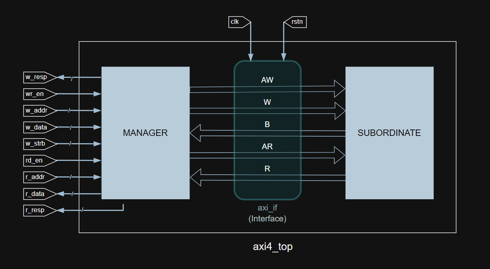
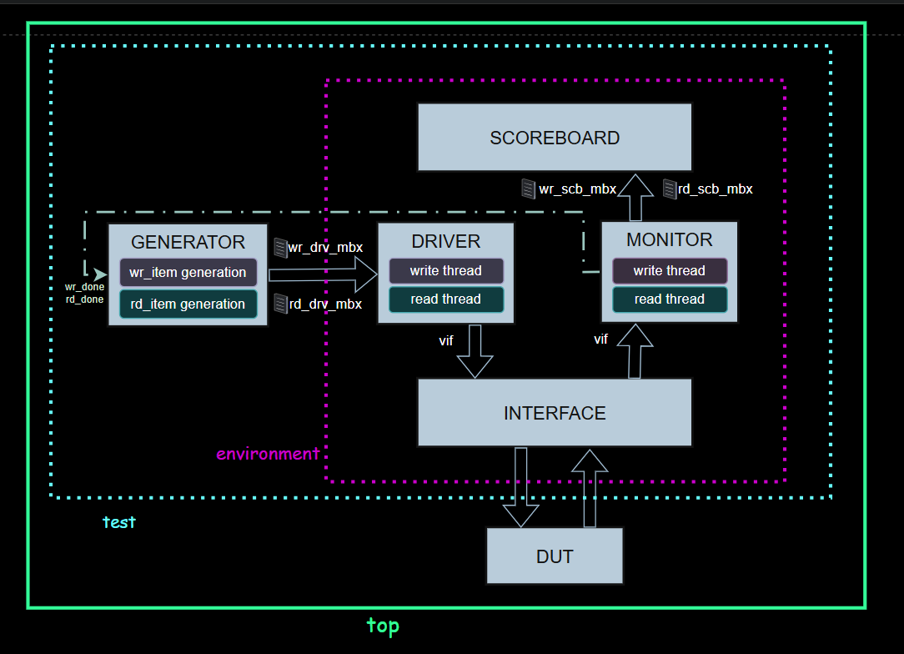
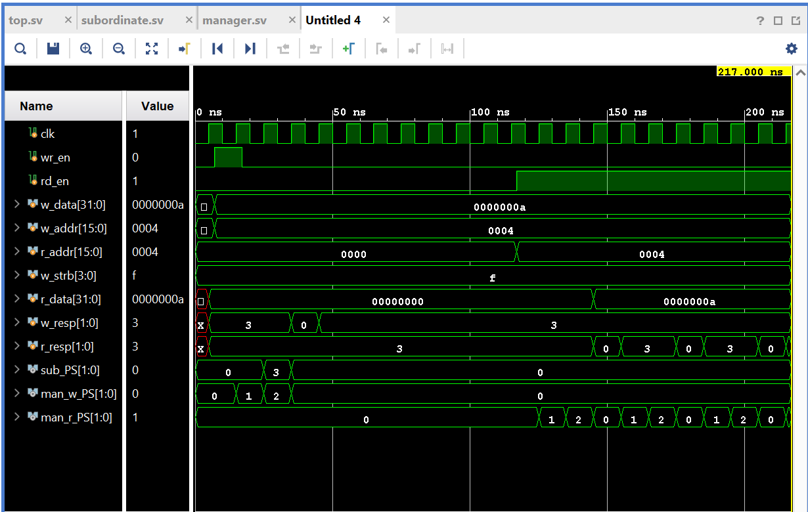
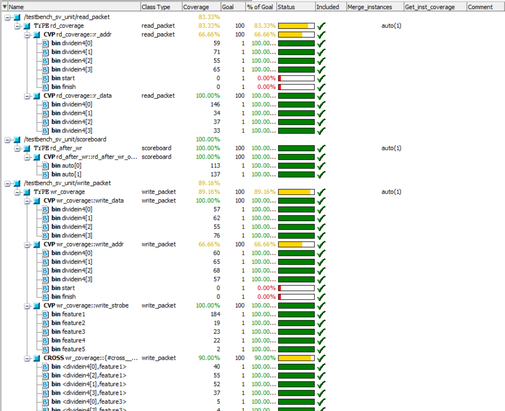
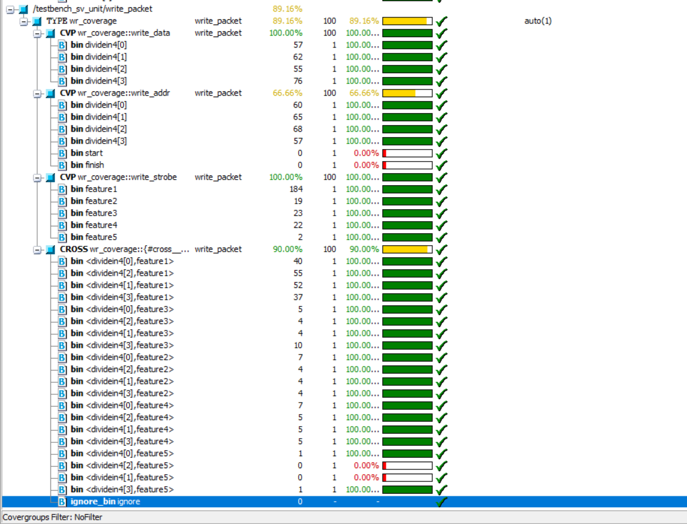

# AMBA AXI4-Lite with custom verification environment

An end-to-end implementation and verification of a custom AMBA AXI4-Lite memory-mapped interface. This project features a fully functional Manager (Master) and Subordinate (Slave) RTL design, validated by a robust, UVM-style SystemVerilog verification environment utilizing parallel split-agents, closed-loop synchronization, and comprehensive SystemVerilog Assertions (SVA).

---

## 📌 Project Highlights
* **Custom RTL Design:** Implemented AXI4-Lite Manager and Subordinate FSMs enforcing strict, single-outstanding-transaction in-order completion.
* **Split-Agent Architecture:** Decoupled Read and Write threads in the Driver and Monitor using parameterized mailboxes (`#(write_packet)` and `#(read_packet)`).
* **Closed-Loop Synchronization:** Implemented dynamic event-triggering (`->wr_done` / `@(wr_done)`) between the Scoreboard/Monitor and Generator to prevent FIFO flooding and precisely control simulation scaling.
* **Sparse Memory Modeling:** Built an associative array reference memory model inside the Scoreboard to handle massive address spaces safely without uninitialized `X` propagation.
* **Metric-Driven Verification:** Achieved **93.19% Global Functional Coverage** utilizing custom cross-coverage bins (address ranges × byte strobes) and Cartesian product pruning (`ignore_bins`).
* **Protocol Compliance (SVA):** Embedded robust assertions into the interface to mathematically prove valid-stability, payload stability (`$stable`), and handshake causality.

---

## 🏗️ RTL Design Architecture

The RTL implements the standard 5-channel AXI4-Lite architecture, optimized for lightweight control register access and memory-mapped I/O.



### AXI4-Lite Channel Specifications
| Channel Name | Direction (Mgr → Sub) | Description |
| :--- | :--- | :--- |
| **Write Address (AW)** | Output | Carries the 32-bit write address and control information. |
| **Write Data (W)** | Output | Carries the 32-bit write data and 4-bit byte strobes (`w_strb`). |
| **Write Response (B)** | Input | Returns the status of the write transaction (e.g., `OKAY`). |
| **Read Address (AR)** | Output | Carries the 32-bit read address and control information. |
| **Read Data (R)** | Input | Returns the 32-bit read data and read response status. |

---

## 🔬 Verification Environment

The testbench is built using Object-Oriented SystemVerilog, mirroring standard UVM hierarchies. To handle AXI's independent read and write channels, the environment utilizes a **Split-Agent Architecture**.



### Key Verification Components
* **Generator:** Randomizes transaction packets based on strict constraints (e.g., correlated strobes) and dispatches them to the respective mailboxes.
* **Driver:** Utilizes `fork...join` blocks to drive read and write requests to the DUT entirely in parallel, eliminating blocking bottlenecks.
* **Monitor:** Passively observes the interface, reconstructing complete transactions upon handshake completions and routing them to the Scoreboard.
* **Scoreboard:** Evaluates responses, verifies read data against the associative array reference model, samples covergroups, and flags transaction completion back to the Generator.

---

## 📊 Results & Coverage

### Waveform Analysis
The simulation confirms perfect interleaving of read and write channels, with properly synchronized transaction IDs (`WID`/`RID`) and valid/ready handshakes.



### Functional Coverage (93.19%)
Coverage was driven by fully randomized, high-volume packet generation (`repeat(250)`). Custom covergroups tracked the distribution of addresses, byte strobes, and crucial corner cases like **Read-After-Write** hits. 

*Cross-coverage matrix specifically tracked the Cartesian product of address divisions against strobe combinations, filtering out invalid architectural states.*




### SystemVerilog Assertions (SVA)
The `axi_if.sv` interface includes continuous background protocol monitoring:
1. **Valid Stability:** Once a `VALID` signal is asserted, it is strictly held until the corresponding `READY` is received.
2. **Payload Stability:** Address and Data signals are locked using `$stable` during wait states to prevent bus corruption.
3. **Causality Checks:** Responses (`B_VALID`, `R_VALID`) are mathematically proven to strictly follow a completed address/data handshake.

---

## 📂 Repository Structure

```text
axi4-lite-vip/
├── docs/                             # Architecture diagrams and coverage reports
│   ├── axi4_lite_design.png
│   ├── axi4_lite_testbench.png
│   ├── coverage_details1.png
│   ├── coverage_details2.png
│   └── function_check_waveform.png
├── rtl/                              # Device Under Test (DUT)
│   ├── axi4_top.sv                   # Top-level integration
│   ├── manager.sv                    # AXI4-Lite Manager FSM
│   └── subordinate.sv                # AXI4-Lite Subordinate FSM
├── sim/                              # Simulation environment
│   ├── cov_report.txt                # Exported QuestaSim coverage matrix
│   └── sim_sv.do                     # Simulator execution script
└── verification/                     # OOP Testbench
    ├── axi_if.sv                     # Interface & SVA definitions
    └── testbench.sv                  # Environment, components, and top module
